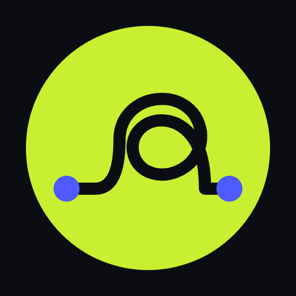

<!-- TODO: demo video link (a GitHub user-attachments link, 30 to 60 seconds). -->

<h1 align="center">Phygital Memory</h1>

<b>A notes app that becomes your second brain. Open source, private, encrypted when you want it, and every file stays yours.</b>

<a href="https://github.com/Phygital-Brain/Phygital-Memory/releases">Download</a> ·
<a href="docs/setup-computer.md">Get started</a> ·
<a href="docs/connect-your-ai.md">Connect your AI</a> ·
<a href="docs/faq.md">Questions</a> ·
<a href="docs/README.md">All guides</a>

<table align="center"><tr>
<td align="center"></td>
<td align="center"></td>
</tr></table>

## What it is

Phygital Memory is a notes app for your computer. You write notes, and your AI app (Claude, Codex, Cursor and others) can read them, search them and help you keep them in order. Over time it becomes a second brain: what you know, decided and planned, in one place your AI can use.

It's built around four promises:

- 🔓 **Open source.** Every line of code is here to read, check and change.
- 🙈 **Private.** No account, no tracking, no server of ours. Your notes stay on your computer unless you choose a cloud or a backup.
- 🔐 **Encrypted when you want it.** Lock a memory with a password. Without it (or your recovery key), the files are unreadable.
- 🗂️ **You own your data.** Notes are normal files. Stop using the app and they're still yours, readable by anything.

## Two kinds of memory

When you make a memory, you pick one:

| | 📂 Open | 🔒 Encrypted |
|---|---|---|
| What it is | A normal folder of Markdown notes | A locked vault, opened with your password |
| Who can read it | Any app, any AI, your phone through a cloud folder | Only this app, and only the AI apps you let in |
| Good for | Notes you're happy for your AI to see anywhere | Clients, money, health, anything private |

You can have both, side by side.

## Your AI, on your terms

- AI apps start **read only**. They can change notes only after you switch on **Allow edits** for each one.
- You choose which memories each AI app can see.
- Every AI change shows in **Activity**, with **Undo**.

More on how it keeps you safe in [Safety](docs/safety.md).

## Get started

1. **Download** the app for your computer from [Releases](https://github.com/Phygital-Brain/Phygital-Memory/releases).
2. **Open it** and make your first memory. It asks a few questions, all clicks.
3. **Connect your AI app.** The app sets up Claude Code for you, and Claude Desktop on a Mac. For others, see [Connect your AI](docs/connect-your-ai.md).

Then ask your AI: *"What's in my Phygital Memory?"*

The full guide, with the first-open steps for each system, is [Get started](docs/setup-computer.md).

## What else it does

- 🔎 Search, a note graph, and version history for every note
- 🗑️ A trash that keeps things for 7 days
- 🤝 Share a memory, a folder or one file with another computer. No account, no cloud.
- ☁️ Keep a memory in iCloud Drive, Dropbox, Google Drive or Nextcloud
- 💾 Back up to a private GitHub repo, WebDAV, Amazon S3 or Cloudflare R2
- 🧠 Turn a memory into a Phygital Brain: ready-made folders and rules for working with AI
- 🌍 41 languages
- 🔄 Updates itself

## Learn more

| | |
|---|---|
| [Get started](docs/setup-computer.md) | Install, first memory, connect your AI |
| [Questions](docs/faq.md) | Quick answers |
| [Safety](docs/safety.md) and [Privacy](docs/privacy.md) | What the app protects, and what leaves your computer |
| [How it works](docs/how-it-works.md) | What happens inside, in plain words |
| [If something goes wrong](docs/troubleshooting.md) | Fixes for common problems |
| [All guides](docs/README.md) | Everything else |

## Help and contributing

Found a bug, have an idea or a question? [Open an issue](https://github.com/Phygital-Brain/Phygital-Memory/issues/new/choose). For a security problem, use a [private report](https://github.com/Phygital-Brain/Phygital-Memory/security/advisories/new).

Want to help? Fixes, docs and translations are all welcome. A native speaker checking one of the 41 languages helps a lot. Start with [CONTRIBUTING.md](CONTRIBUTING.md).

## Credits and license

Made by [Phygital-Brain](https://github.com/Phygital-Brain) and the [contributors](CONTRIBUTORS.md). Encrypted memories use the [Cryptomator](https://cryptomator.org) vault format, so Cryptomator can open them too. Not made by or affiliated with Cryptomator. Sharing uses [Syncthing](https://syncthing.net), and cloud storage uses [rclone](https://rclone.org). Design ideas come from [Baalda](https://github.com/naveedharri/baalda). No Baalda code is included. More in [NOTICE](NOTICE).

Free and open source under the [AGPL-3.0](LICENSE). A commercial license is available: [open an issue](https://github.com/Phygital-Brain/Phygital-Memory/issues) to ask.
