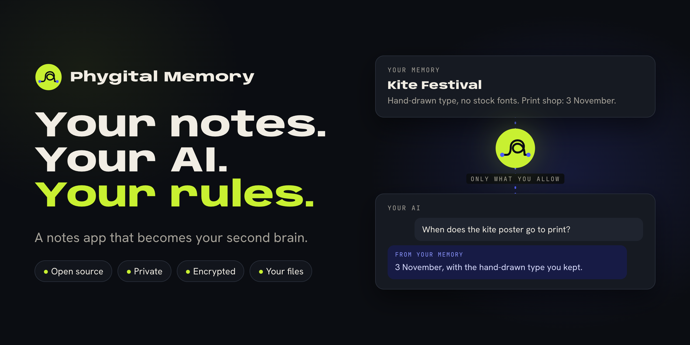
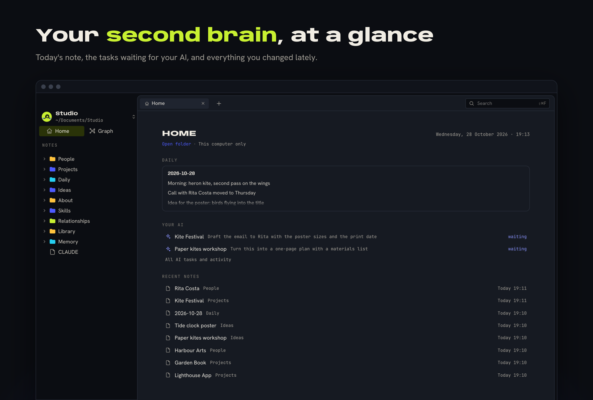
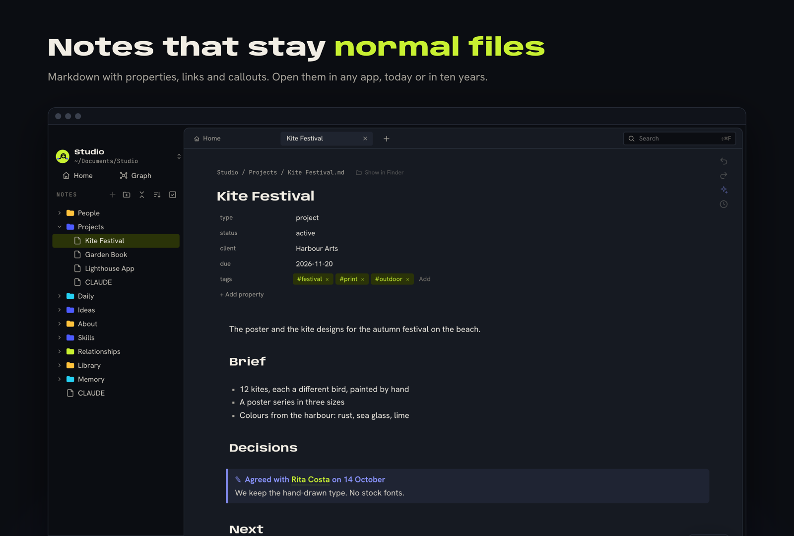
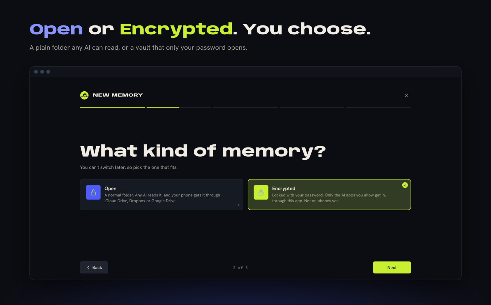
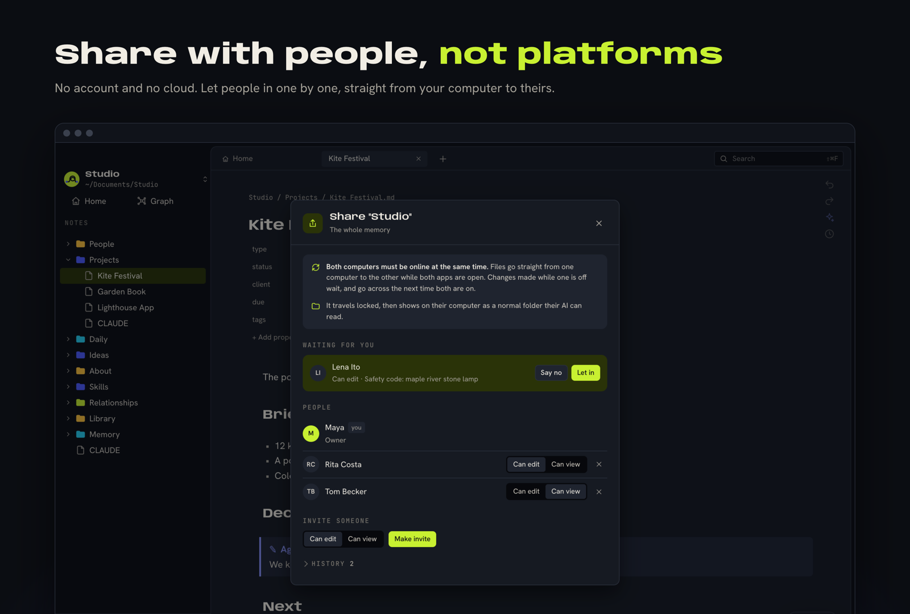

<!-- TODO: demo video link (a GitHub user-attachments link, 30 to 60 seconds). -->

<p align="center"></p>

<h1 align="center">Phygital Memory</h1>

<p align="center"><b>A notes app that becomes your second brain.<br>Open source, private, encrypted when you want it, and every file stays yours.</b></p>

<p align="center">
<a href="LICENSE"></a>
<a href="docs/privacy.md"></a>
<a href="docs/how-it-works.md"></a>
<a href="docs/setup-computer.md"></a>
<a href="https://github.com/Phygital-Brain/Phygital-Memory/releases/latest"></a>
</p>

<p align="center">
<a href="https://github.com/Phygital-Brain/Phygital-Memory/releases">Download</a> ·
<a href="docs/setup-computer.md">Get started</a> ·
<a href="docs/connect-your-ai.md">Connect your AI</a> ·
<a href="docs/faq.md">Questions</a> ·
<a href="docs/README.md">All guides</a>
</p>

## What it is

Phygital Memory is a notes app for your computer. You write notes, and your AI app (Claude, Codex, Cursor and others) can read them, search them and help you keep them in order. Over time it becomes a second brain: what you know, decided and planned, in one place your AI can use.

It's built around four promises:

- **Open source.** Every line of code is here to read, check and change.
- **Private.** No account, no tracking, no server of ours. Your notes stay on your computer unless you choose a cloud or a backup.
- **Encrypted when you want it.** Lock a memory with a password. Without it (or your recovery key), the files are unreadable.
- **You own your data.** Notes are normal files. Stop using the app and they're still yours, readable by anything.

<p align="center"></p>

## Install

Get the app from the [Releases page](https://github.com/Phygital-Brain/Phygital-Memory/releases). Pick the file for your computer:

| Computer | Download | Then |
|---|---|---|
| Mac (Apple chip or Intel) | `..._universal.dmg` | Open it and drag **Phygital Memory** into **Applications**. The first time, right-click the app and choose **Open**. |
| Windows | `..._x64-setup.exe` | Run it and follow the steps. If Windows asks, choose **More info**, then **Run anyway**. |
| Linux (Ubuntu, Debian) | `..._amd64.deb` (or `_arm64.deb`) | Open it with your software installer. |
| Linux (Fedora, openSUSE) | `....rpm` | Open it with your software installer. |
| Linux (any other) | `....AppImage` | See [Get started](docs/setup-computer.md#1-get-the-app). |

It updates itself after that.

## How to use

1. **Make a memory.** Open the app and press **New memory**. Give it a name, pick **Open** or **Encrypted**, choose where it lives, and press **Set it up**. The app builds a ready-made set of folders for you (a Phygital Brain), or you can start empty.
2. **Write.** Press **New note**, or open a folder on the left. Notes are Markdown. **Home** shows today's note and what you changed lately. Search finds anything across your memories.
3. **Connect your AI.** In **Settings › AI apps**, press **Add to Claude Code**, or **Download** the extension for Claude Desktop (Mac). For Codex, Cursor and others, see [Connect your AI](docs/connect-your-ai.md).
4. **Ask your AI.** Keep the app open and ask things like *"Search my memory for the logo brief"* or *"What did I decide about pricing?"*. More ideas in [Things to ask](docs/examples.md).
5. **Let it write, when you're ready.** Switch on **Allow edits** for that AI app in **Settings › AI apps**. Every change it makes shows in **AI tasks and activity**, with **Undo**.
6. **Give it work.** On any note, press **Give AI a task** and say what you want. Then tell your AI *"Do my Phygital Memory tasks."*
7. **Lock it.** An Encrypted memory locks with **Lock** and opens again with your password (or Touch ID on a Mac).
8. **Share and back up.** From the memory's menu, **Share** sends an invite to someone, and **Storage and backup** keeps a copy on GitHub, WebDAV, S3 or R2.

The full walkthrough is in [Get started](docs/setup-computer.md).

<p align="center"></p>

## Two kinds of memory

When you make a memory, you pick one:

| | Open | Encrypted |
|---|---|---|
| What it is | A normal folder of Markdown notes | A locked vault, opened with your password |
| Who can read it | Any app, any AI, your phone through a cloud folder | Only this app, and only the AI apps you let in |
| Good for | Notes you're happy for your AI to see anywhere | Clients, money, health, anything private |

You can have both, side by side.

<p align="center"></p>

## Your AI, on your terms

- AI apps start **read only**. They can change notes only after you switch on **Allow edits** for each one.
- You choose which memories each AI app can see.
- Every AI change shows in **Activity**, with **Undo**.

More on how it keeps you safe in [Safety](docs/safety.md).

## Privacy

- **No account, no tracking.** The app never asks who you are and sends no usage data. There is no server of ours.
- **On your computer.** Your notes stay where you put them. They go online only if you choose a cloud folder, a backup or sharing.
- **Unreadable without your password.** An Encrypted memory, file names included, can't be read without your password or recovery key, even in your cloud or backup.
- **The AI sees what you allow.** Each AI app gets its own key and only the memories you pick.

The full list of what leaves your computer, and when, is in [Privacy](docs/privacy.md).

## Words you'll see

| Word | What it means here |
|---|---|
| **Memory** | One folder of notes the app looks after. You can have several. |
| **Open memory** | A plain folder of readable notes. No password. Any AI app or program that can open the folder can read it. |
| **Encrypted memory** | A locked folder (a Cryptomator format 8 vault). You open it with your password, or Touch ID on a Mac. |
| **Recovery key** | 44 words that let you set a new password for an Encrypted memory. Keep them offline. |
| **AI app** | Claude Code, Claude Desktop, Codex, Cursor or any app that can use tools through MCP. |
| **MCP** | Model Context Protocol: the standard way AI apps plug into tools like this one. |
| **The AI door** | The part of the app that AI apps talk to, at `http://127.0.0.1:8790/mcp`. It exists only while the app is open. |
| **Allow edits** | The switch that lets one AI app change notes. Off means read only. |
| **Private for AI** | A folder or note the AI opens only when you ask in the chat. The tools follow this rule. The folder itself stays readable. |
| **AI tasks** | A hidden note in each memory where you leave work for your AI. It is never shared. |
| **Phygital Brain** | An optional set of folders, rules and first notes for working with an AI. The app can build it for you. |

## What it can do

- **Write and find.** An editor, search across your memories, a note graph, and **Version history** for every note.
- **Undo.** A trash that keeps things for 7 days, and **Undo** for every change an AI made.
- **Let AI apps in, one by one.** 17 tools for search, read, write, move, trash and AI tasks. See [docs/tools.md](docs/tools.md).
- **AI tasks.** Press **Give AI a task** on a note, then ask your AI *"Do my Phygital Memory tasks."*
- **Back up.** To a private GitHub repo, a WebDAV server, Amazon S3 or Cloudflare R2, or one backup file. Encrypted memories are backed up as encrypted files.
- **Share from computer to computer.** A whole memory, one folder or one file, with **Can edit** or **Can view**, through Syncthing. No account and no cloud. You link your own second computer the same way.
- **Use cloud folders.** Put a memory in iCloud Drive, Dropbox, Google Drive or Nextcloud. For an Encrypted memory the cloud sees only encrypted files.
- **Make it a Phygital Brain.** One setup page builds folders, rules and first notes, and leaves one AI task for your AI to finish the rest.

Ideas for what to ask are in [docs/examples.md](docs/examples.md).

<p align="center"></p>

## Languages

The app's screens come in 41 languages. It follows your computer's language, or you pick one in **Settings › General › Language**. The translations were made with AI and checked by a script. A native speaker's eye always helps: see [docs/languages.md](docs/languages.md) and [core/languages/TRANSLATING.md](core/languages/TRANSLATING.md). The AI tools and these docs stay in English, and your AI app answers you in your own language.

## All the guides

| Guide | Read it when |
|---|---|
| [Guides index](docs/README.md) | You want every guide on one page |
| [Setup on your computer](docs/setup-computer.md) | You want to install the app and make your first memory |
| [Connect your AI app](docs/connect-your-ai.md) | You want Claude Code, Claude Desktop, Codex, Cursor or another AI app to use your memory |
| [Claude Desktop extension](docs/claude-desktop-extension.md) | You use Claude Desktop and want to connect it with one file |
| [Things to ask](docs/examples.md) | You are not sure what to say to your AI |
| [The AI tools](docs/tools.md) | You want the list of everything an AI app can do |
| [Settings](docs/settings.md) | You want to change how the app works, or find where something is kept |
| [Safety](docs/safety.md) | Before you let an AI read or change your notes |
| [Privacy](docs/privacy.md) | You want to know what leaves your computer and who can see what |
| [Threat model](docs/threat-model.md) | You want to know what the app protects against, and what it cannot |
| [How it works](docs/how-it-works.md) | You want to know what happens inside, in plain words |
| [Updates](docs/updates.md) | You want to know how the app gets updated |
| [Languages](docs/languages.md) | You want the app in another language |
| [Translating](core/languages/TRANSLATING.md) | You want to add a language or fix a translation |
| [Questions people ask](docs/faq.md) | You have a quick question |
| [If something goes wrong](docs/troubleshooting.md) | Something does not work |
| [Roadmap](docs/roadmap.md) | You want to know what might come next |
| [SECURITY.md](SECURITY.md) | You found a security problem |
| [CHANGELOG.md](CHANGELOG.md) | You want to know what changed in each version |
| [CONTRIBUTING.md](CONTRIBUTING.md) | You want to report a bug or send a change |
| [CONTRIBUTORS.md](CONTRIBUTORS.md) | You want to see who helped, or be added |
| [GOVERNANCE.md](GOVERNANCE.md) | You want to know how decisions are made |
| [SUPPORT.md](SUPPORT.md) | You need help and don't know where to ask |
| [CODE_OF_CONDUCT.md](CODE_OF_CONDUCT.md) | You want to know how people behave here |
| [TRADEMARKS.md](TRADEMARKS.md) | You want to use the name or the logo |
| [AGENTS.md](AGENTS.md) | You (or your AI coding agent) want to change the code |

## This repository

| Folder or file | What it is |
|---|---|
| [`core/phygital_memory/`](core/phygital_memory) | The engine (Python): memories, encryption, search, sharing, backups, the AI door. |
| [`core/phygital_memory/vault/`](core/phygital_memory/vault) | How a memory is stored: `plain.py` for Open memories, the rest for Encrypted ones. |
| [`core/frontend/`](core/frontend) | The app's screens (JavaScript). They build into `core/phygital_memory/web/`. |
| [`core/languages/`](core/languages) | Every screen text in 41 languages. `en.json` is the source. |
| [`core/tests/`](core/tests) | Every test, the sample notes they use, and `run.sh` to run one. |
| [`core/packaging/`](core/packaging) | Turns the engine into one program, plus the Touch ID and Keychain helper (Mac only). |
| [`core/scripts/`](core/scripts) | Small tools, such as `i18n.py` for the screen texts. |
| [`app/`](app) | The window around it all (Tauri, Rust): starts the engine, draws the menu bar, asks before closing. |
| [`brand/`](brand) | Logo, colours, icons and the brand guide. |
| [`rebuild.sh`](rebuild.sh) | Builds the Mac app and makes the `.dmg`. |

To build the Mac app yourself you need `uv`, `npm`, Rust with `cargo tauri`, `syncthing` and `rclone`. Then run:

```bash
bash rebuild.sh --install
```

You should see a `.dmg` in `release/`, and the app replaced in Applications and reopened. The first build takes longer, because it fetches the build tools. The Windows and Linux apps are built on GitHub. To run one test:

```bash
sh core/tests/run.sh test_open.py
```

You should see PASS or FAIL for each check. More for developers in [AGENTS.md](AGENTS.md) and [CONTRIBUTING.md](CONTRIBUTING.md).

## Help and feedback

| You want to | Go to |
|---|---|
| Fix a problem yourself | [If something goes wrong](docs/troubleshooting.md) |
| Report a bug | [Something doesn't work](https://github.com/Phygital-Brain/Phygital-Memory/issues/new?template=bug_report.yml) |
| Suggest an idea or a feature | [Idea or feature](https://github.com/Phygital-Brain/Phygital-Memory/issues/new?template=feature_request.yml) |
| Ask a question | [Question](https://github.com/Phygital-Brain/Phygital-Memory/issues/new?template=question.yml) |
| Ask for a commercial license | [Open an issue](https://github.com/Phygital-Brain/Phygital-Memory/issues) |
| Report a security problem, privately | [Private report](https://github.com/Phygital-Brain/Phygital-Memory/security/advisories/new) ([SECURITY.md](SECURITY.md)) |

Issues are public, so leave out passwords, keys and private notes.

## Contributors

Everyone who helps is listed in [CONTRIBUTORS.md](CONTRIBUTORS.md). Fixes, docs and translations are all welcome, and a native speaker checking one of the 41 languages helps a lot. Add yourself when you send a pull request.

## Credits

Phygital Memory is made by [Phygital-Brain](https://github.com/Phygital-Brain) and the Phygital Memory contributors. The vault code and the Finder view come from Encryptor MCP, by the same author, under the same license.

It builds on the work of others:

- **Cryptomator.** Encrypted memories use the Cryptomator vault format (version 8), so Cryptomator can open them. The app contains no Cryptomator code. Not made by or affiliated with Cryptomator or Skymatic. "Cryptomator" is a name and trademark of its owners.
- **Syncthing** (MPL-2.0) for sharing between computers, and **rclone** (MIT) for WebDAV and S3 or R2. The built app bundles both unchanged.
- **Tauri** for the app window, and the libraries listed in [`core/uv.lock`](core/uv.lock) (Python), [`core/frontend/package-lock.json`](core/frontend/package-lock.json) (JavaScript) and [`app/src-tauri/Cargo.lock`](app/src-tauri/Cargo.lock) (Rust), each under its own license. The app lists the bundled programs under **Settings › Licences**.
- **Baalda.** Design and feature ideas, including the style of some sidebar icons, come from [Baalda](https://github.com/naveedharri/baalda) (Apache-2.0). No Baalda code is included.

You're welcome to use, fork, change and build on it under the GNU Affero General Public License, version 3 only (AGPL-3.0-only), and the notices in [NOTICE](NOTICE). In short:

- Keep [LICENSE](LICENSE), [NOTICE](NOTICE) and the copyright lines.
- If you share a changed version, or run one that other people use over a network, offer them its source code under the same license.
- Mark your version as changed.

GitHub's "Cite this repository" button uses [CITATION.cff](CITATION.cff).

## License

[GNU Affero General Public License, version 3 only](LICENSE) (AGPL-3.0-only), with the notices in [NOTICE](NOTICE). A commercial license is also available for use without the AGPL's terms: [open an issue](https://github.com/Phygital-Brain/Phygital-Memory/issues) to ask. Copyright (C) 2026 Phygital-Brain and Phygital Memory contributors.
