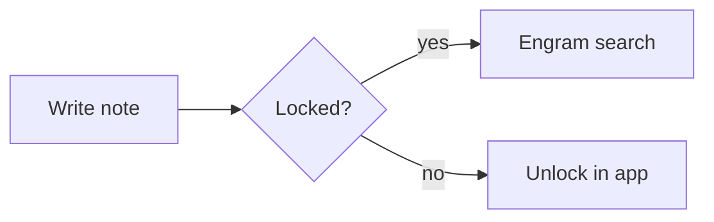

# Markdown showcase

This line has **bold**, *italic*, ~~strikethrough~~, ==highlight==, `inline code`, a [web link](https://example.com), a link to [[Tom-Becker|Tom]], a [[Missing Note]] and a tag #design/ui. A footnote too[^1].

## Lists
- First bullet
- Second bullet
  - Nested bullet
1. One
2. Two
- [ ] An open task
- [x] A finished task

## Quote and callouts
> A plain quote, with *style*.

> [!note] A note callout
> With **bold** inside.

> [!tip] Tip
> Green family.

> [!warning] Careful
> Amber family.

> [!danger] Danger
> Red family.

## Table
| Name | Role | Score |
|------|:----:|------:|
| Mira | **Client** | 9 |
| Tom | Sound | 7 |

## Code
```python
def hello(name: str) -> str:
    return f"Hello {name}"  # greet
```

---

## Image
![[test-image.png|240]]

[^1]: The footnote text.

## More
%%This is a hidden comment%%

> [!tip]- Folded tip
> This callout starts folded.



![[people.csv]]

- Parent item
  - Child item
    - Grandchild item
