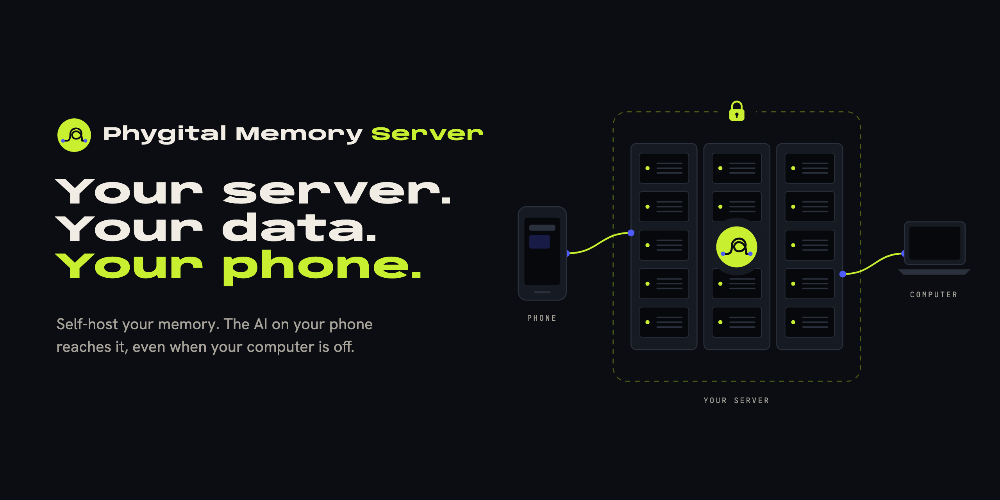

# Run it on your own server

<p align="center"></p>

Phygital Memory Server is the same app on a server you own, without the window. It is open all the time, so the AI apps on your phone can reach your memories even when your computer is off.

You get two things at your address, say `https://memory.example.com`:

- **The page.** The same screens as the desktop app, in your browser, behind a passphrase. You make and unlock memories, write notes, connect AI apps and set up backups there.
- **The AI door** at `https://memory.example.com/mcp`. Claude, ChatGPT and any other AI app that speaks MCP connect to it, on your computer or your phone.

## What it can reach

It reaches only the memories on the server, never your computer.

- The same 17 tools as the desktop app ([the list](tools.md)). Search goes through Engram, like on your computer.
- Every AI app starts **read only**. You choose which memories it sees, and turn on **Allow edits** for each one.
- **Encrypted memories** open only after you unlock them on the page. They stay open in the server's memory until you lock them or the server restarts. Their passwords are never written down.

Things that need a computer are not on the server: Touch ID, Finder, and choosing files with your computer's own file chooser (backup files, import and export). Do those in the desktop app.

## Deploy it

Pick one. Each gives you an address with HTTPS, and keeps your memories on a disk that survives restarts.

### One click

<p align="center">
<a href="https://railway.com/deploy/phygital-memory"></a>
<a href="https://render.com/deploy?repo=https://github.com/Phygital-Brain/Phygital-Memory"></a>
<a href="#docker-compose-on-any-server"></a>
</p>

- **Railway:** press the button, then Deploy. Railway gives the server its address and a disk.
- **Render:** press the button, then Apply. It uses Render's smallest paid plan, because the free one has no disk.

On both, the server picks up its address by itself. Then open the address Railway or Render shows you, for [the first visit](#the-first-visit).

On Railway and Render there is no WebDAV drive (they don't allow one), and syncing with your computer goes through relays, which is a little slower.

### Coolify

1. In Coolify, add a new resource, choose **Docker Compose**, and paste [`server/compose.yaml`](../server/compose.yaml).
2. Coolify does HTTPS for you, so delete the `caddy` part and give the `memory` service your domain, on port 8790.
3. Set `DOMAIN` to that domain, and deploy.

### Docker Compose, on any server

You need a domain or subdomain pointing at the server, like `memory.example.com`.

1. Copy the [`server`](../server) folder from this repository to your server.
2. Copy `.env.example` to `.env` and fill in `DOMAIN`.
3. Start it:

```bash
docker compose up -d
```

Caddy gets the HTTPS certificate on its own.

### Docker, by hand

If you already have HTTPS in front of it, run the image and point your address at port 8790:

```bash
docker run -d --name phygital-memory --restart unless-stopped -p 8790:8790 -p 22000:22000 -p 22000:22000/udp -v phygital-memory:/data -e PHYGITAL_MEMORY_URL=https://memory.example.com ghcr.io/phygital-brain/phygital-memory:latest
```

## The first visit

Open your server's address. It asks you to choose its passphrase: 12 characters or more, used nowhere else. First it wants the setup code it wrote in its log, so nobody who finds the address before you can claim the server. The page shows where the log is for each host. With Docker Compose:

```bash
docker compose logs memory
```

The code stays the same until you set the passphrase. After that, the page asks for your passphrase.

## Settings

| Setting | What it is |
|---|---|
| `PHYGITAL_MEMORY_URL` | The address people open, like `https://memory.example.com`. Not needed on Railway and Render, which give it to the server |
| `PHYGITAL_MEMORY_PASSPHRASE` | Optional. Sets the passphrase as a setting instead of on the first visit. 12 characters or more |
| `PHYGITAL_MEMORY_DATA` | Where memories and settings live. `/data` in the image: keep it on a disk that survives restarts |
| `PHYGITAL_MEMORY_SYNC_PORT` | The port for syncing with your computers. `22000` in the image |
| `PHYGITAL_MEMORY_SYNC_ADDRESS` | Optional. Where computers reach that port, like `tcp://memory.example.com:22000`. By default your address's name and the sync port |

The passphrase chosen on the first visit is never written down. The server keeps only a fingerprint of it. To choose a new one, delete `state/passphrase.json` on the `/data` disk and restart. The first visit comes back, with a new setup code. If you set `PHYGITAL_MEMORY_PASSPHRASE`, keep it in your host's secret settings or in `.env`, never in a file you share.

## Connect your AI apps

On the page, open **Settings**, **AI apps**.

- **Claude (website, desktop and phone) and ChatGPT:** add a custom connector with your server's address and `/mcp` at the end. The AI app opens your server's page. Sign in with your passphrase and press **Allow**.
- **Other AI apps:** make a key in **AI apps** and paste the address and key into the AI app's setup.

More in [Connect your AI app](connect-your-ai.md).

## Keep it in step with your computer

There are two ways, and you can use both:

- **Link your computer.** In the desktop app, open Settings, Sharing and AI, **Link a computer**, and choose **To my server**. Type the server's address and passphrase and press Connect. The app signs in, links the two and checks the safety words for you. Pick the memories and press **Link**. They then sync straight between your computer and the server, still encrypted. The server is always on, so your computer catches up whenever the app is open.
- **The same storage.** The desktop app and the server both open the same WebDAV or Nextcloud folder. On the server this needs the four WebDAV lines in `compose.yaml`.

If the same note changes in both places at once, both copies are kept, and **Version history** lets you go back.

## Updates

Every release also builds a new server image. The page tells you when a newer version is out. To update:

```bash
docker compose pull && docker compose up -d
```

On Coolify, Render and Railway, press Redeploy. Your memories and settings stay on the `/data` disk. After an update, unlock your Encrypted memories again.

## Safety

- The page and the AI door are on the internet, so the passphrase is the lock. Make it long. Ten wrong tries close the door for 15 minutes.
- A login lasts 30 days, or until the server restarts. **Sign out** is at the bottom of the side bar.
- Secrets the desktop app keeps in your computer's keychain (cloud passwords, the GitHub key, your sharing key) are kept on the server in one file that only the server can read.
- Anyone who controls the server can see unlocked memories while they are open. Use a server you trust. More in [Threat model](threat-model.md).
